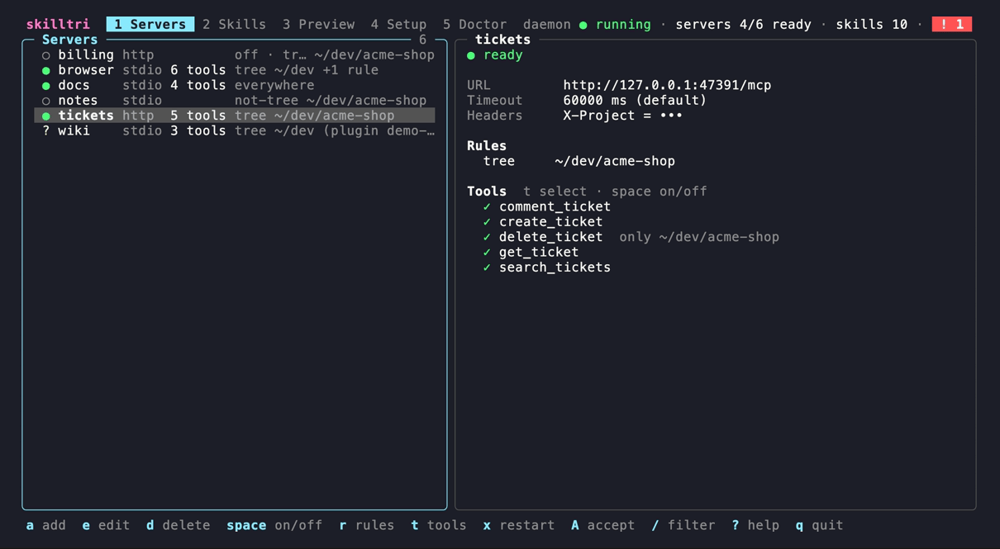
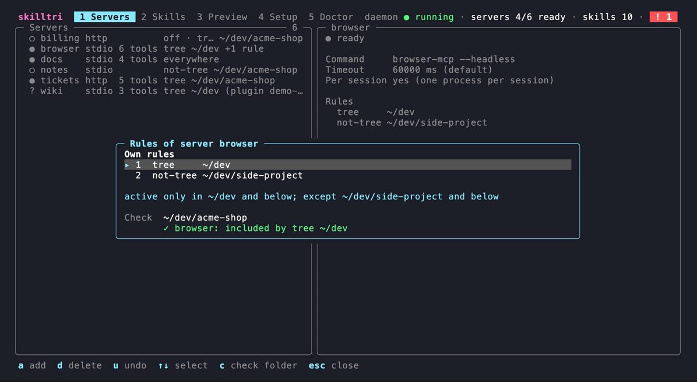
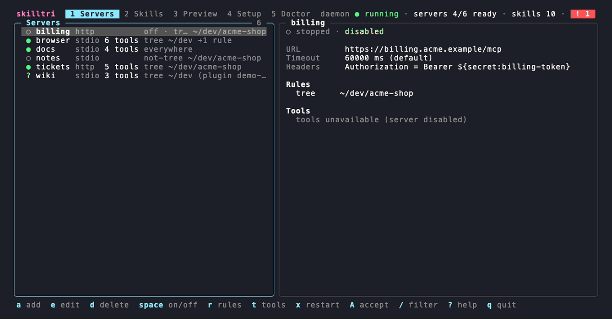
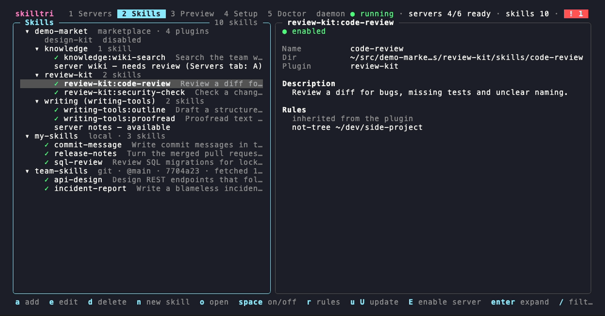
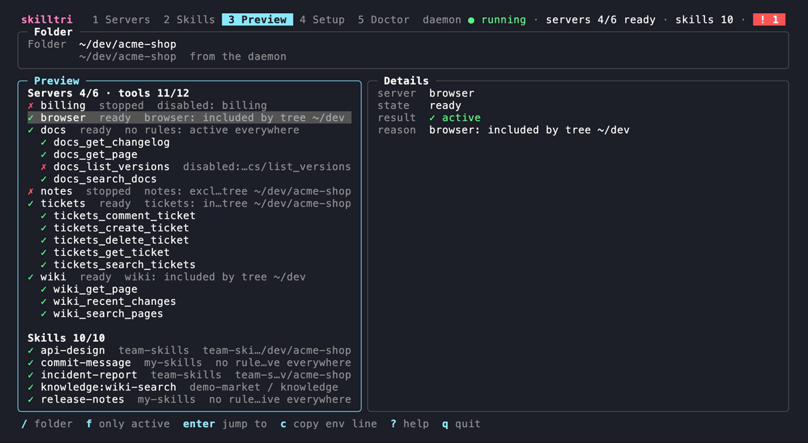
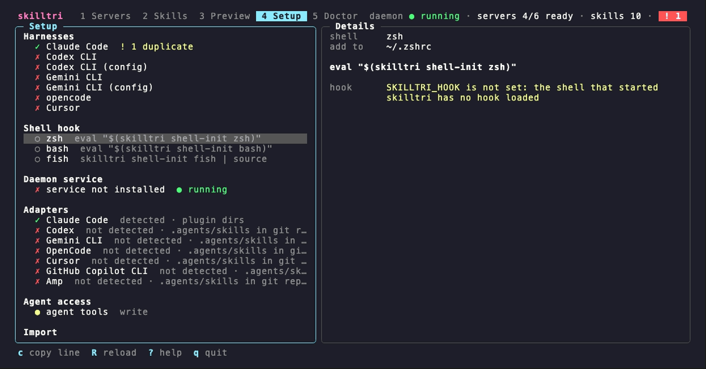
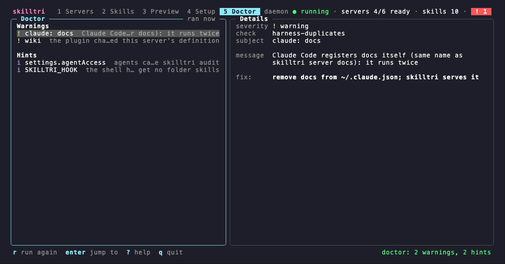

# skilltri

One **MCP gateway** and one **agent skill manager** for all your AI agent harnesses, with **per-folder rules** for both. You add MCP servers and skill sources (local folders, git repos, Claude plugin marketplaces) once, decide in which folders each one is active, and every harness gets exactly that set: Claude Code natively, Codex, Gemini CLI, OpenCode, Cursor, Copilot CLI and Amp through `.agents/skills` links, and anything else that speaks MCP through the gateway.

- **You** run `skilltri` in any terminal: a TUI to manage servers, skill sources and the folder rules that decide where each one is active, plus a preview of what a session in a given folder gets.
- **Agents** get everything through two channels: one MCP server (`skilltri mcp`, stdio) that only exposes the tools that apply to the session's folder, and native skill folders that skilltri builds per folder for each harness.



*Servers: status, transport, tool count and the rules summary per server; the selected server with its own rules and its tools, one of them limited to a single folder.*

Status: **v0.1.0**, macOS and Linux. See [Not supported yet](#not-supported-yet).

## Why

- A plain MCP gateway (such as 1MCP) exposes every server everywhere. Work, client and private projects need different servers, and should not see each other's tools.
- Skills live in harness-specific folders (`~/.claude/skills`, `.agents/skills`, plugin caches). A user-level folder cannot differ per session, so "everywhere except this project" is impossible.
- Skills from git repos and marketplaces should stay up to date without manual pulls.

skilltri replaces the gateway and the harness-specific skill folders with one config and one set of rules.

## How it works

```
 harness (Claude Code, Codex, …)                       skilltri daemon
 started in ~/dev/acme-shop                            (one per user, Unix socket)
 ├─ MCP: skilltri mcp  ── stdio ── thin shim ── socket ──► sessions, rules, downstream servers
 │                                                         ├─ stdio servers (started on demand)
 │                                                         └─ Streamable HTTP servers
 └─ skills: CLAUDE_CODE_PLUGIN_DIRS=~/.cache/skilltri/views/<set>/claude-code/…
            (set by the shell hook or `skilltri run` before the harness starts)
```

- **`skilltri daemon`** holds the connections to the downstream MCP servers, fetches skill sources on a schedule, builds the skill views and reloads the config when it changes. It listens on a Unix socket in the state dir. You can install it as a login service (`skilltri daemon install`); otherwise the first `skilltri mcp` starts it in the background.
- **`skilltri mcp`** is the one MCP server you register in each harness. It is a thin stdio process: it tells the daemon the session folder and relays the JSON-RPC stream. The daemon exposes only the servers and tools whose rules match that folder, as `<server>_<tool>`, and sends `tools/list_changed` when a config change alters a session's set. Tools, prompts and resources are passed through.
- **The session folder** is `--cwd DIR` or `$SKILLTRI_CWD` if given, else the single MCP root the client sends, else the working directory of `skilltri mcp` (harnesses start stdio servers in the project folder).
- **Claude Code skills** come in through views: for a folder, skilltri computes the active skills and builds a directory of generated plugins under `~/.cache/skilltri/views/` (symlinks to the real skill folders, so plugin namespaces such as `review-kit:code-review` survive). The shell hook exports `CLAUDE_CODE_PLUGIN_DIRS` pointing there on every `cd`. The view lives outside the project because Claude Code also reads skills from parent folders, which would break `only` and `not-tree` rules.
- **`.agents/skills` harnesses** (Codex, Gemini CLI, OpenCode, Cursor, Copilot CLI, Amp) have no way to redirect their skill folder yet, so their adapters are opt-in and fall back to symlinks in `<session folder>/.agents/skills/`, recorded in `.agents/skills/.skilltri.json`, added to `.git/info/exclude` and removed again when they no longer apply. Links are only made inside a git work tree, never in `$HOME` or above it. Because these harnesses read parent folders too, a link in a project is also seen from its subfolders.
- **MCP fallback:** for harnesses without a native view, `skilltri mcp` lists the active skills in its server instructions and offers `skilltri_load_skill` and `skilltri_read_skill_file`. It switches this off for sessions that already get a native view, so skills never show up twice.

## Folder rules

Every MCP server, tool, skill source, plugin and skill can carry rules. A rule is a path plus one of four modes:

| Mode | Active when the session folder is … |
|---|---|
| `only` | exactly this folder |
| `tree` | this folder or any folder below it |
| `not` | any folder except exactly this one |
| `not-tree` | any folder except this one and the folders below it |

- **No rules = active everywhere.**
- **Excludes win.** `only`/`tree` are includes, `not`/`not-tree` are excludes. An item is active if it has no includes or at least one include matches, **and** no exclude matches.
- **The nearest level decides.** The levels are source → plugin → skill and server → tool. Each level has an on/off switch, and an item is active only if all its ancestors are on. Its rules are those of the nearest level that has any: a skill's own rules replace its plugin's, which replace the source's.
- Paths are compared after `~` expansion, cleaning and symlink resolution, so `~/dev` and `/Users/you/dev` match. Matching is path-only.

Examples:

| Rules on the item | Active in `~/dev/acme-shop` | in `~/dev/acme-shop/api` | in `~/dev/side-project` |
|---|---|---|---|
| none | yes | yes | yes |
| `tree ~/dev/acme-shop` | yes | yes | no |
| `only ~/dev/acme-shop` | yes | no | no |
| `tree ~/dev` + `not-tree ~/dev/side-project` | yes | yes | no |
| `not ~/dev/acme-shop` | no | yes | yes |

```sh
skilltri rule add server/tickets tree ~/dev/acme-shop
skilltri rule add server/tickets/tool/delete_ticket only ~/dev/acme-shop
skilltri rule add source/demo-market/plugin/review-kit not-tree ~/dev/side-project
skilltri which ~/dev/acme-shop     # what a session there gets, and which rule decided
```

Targets are `server/NAME[/tool/TOOL]` and `source/NAME[/plugin/ENTRY|/skill/ID]` (`ENTRY` is the plugin's name in the marketplace, the `ID` of a plugin skill is `<plugin>:<skill>`). In the TUI, **r** opens the rules editor on the selected item.



*The rules editor: the server's own rules, what they mean in plain words, and a check that shows which rule decides for a folder.*

## Skill sources

| Type | What | Updates |
|---|---|---|
| `local` | any folder you point at, or `~/.config/skilltri/skills/` (`skilltri skill new NAME` creates a skill there and the source `local` for it; **n** in the Skills tab) | none, read live |
| `git` | GitHub shorthand `owner/repo` or any git URL, optional `--ref` (branch, tag or commit) and `--subpath`; may contain many skills | fetched by the daemon |
| `marketplace` | a repo or folder with `.claude-plugin/marketplace.json` | fetched by the daemon, then the plugins are resolved again |

```sh
skilltri source add local my-skills ~/skills
skilltri source add git team-skills acme/team-skills --ref main --subpath skills
skilltri source add marketplace demo-market acme/demo-market --plugins disabled
skilltri enable source/demo-market/plugin/review-kit
skilltri update                    # fetch all git and marketplace sources now
```

- **Discovery:** every folder with a `SKILL.md` below the source (or its subpath) is a skill, following the agentskills.io format (`name` of `a-z`, `0-9` and `-`, at most 64 characters, matching the folder name; `description` at most 1024 characters). Invalid frontmatter is a warning in Doctor, not an error.
- **Updates:** the daemon fetches every `git` and `marketplace` source once an hour by default; `--every 30m` changes the interval per source, `--every 0` means manual only (`skilltri update [source…]`, or **u**/**U** in the Skills tab).
- **Pinning:** a `--ref` that is a full commit SHA is pinned and never moves. A lock file in the state dir records the fetched commit and a content hash per skill, so Doctor notices local changes to a checkout.
- **Marketplace plugins:** relative paths, `github`, `url` (git) and `git-subdir` plugin sources are supported. From each plugin skilltri takes `skills/` plus the extra paths of a `skills` key in `plugin.json`; plugin skills keep their namespace (`review-kit:code-review`). Plugins are on by default; `--plugins disabled` turns them off unless you enable them one by one, so plugins added upstream later stay off. Disabled plugins are never fetched.
- **Plugin MCP servers** (a plugin's `.mcp.json`) are listed as *available, off*. Switching one on (`skilltri plugin-server enable SOURCE/PLUGIN/SERVER`, or **E** in the Skills tab) makes it a normal gateway server with a copy of the plugin's effective rules. If an update later changes its definition (command, args, URL, env), the server keeps running the old definition and is marked **needs review** until you accept the change (`skilltri plugin-server accept NAME`, or **A** in the Servers tab). A server that runs code from the plugin folder is also marked when the plugin's checkout moves to another commit.
- Hooks, subagents, LSP servers, `bin/` and settings of plugins are not taken over.

## Setup guide

This walks you from nothing to a working setup. Each step ends with a check, so you know it worked before you move on. Nothing in steps 1–3 touches your harnesses, so you can try skilltri next to your current setup first.

### Requirements

- macOS or Linux
- `git` on `PATH` (for git and marketplace sources)
- One or more agent harnesses: Claude Code, Codex CLI, Gemini CLI, opencode, Cursor, GitHub Copilot CLI or Amp

### 1. Install

```sh
brew install baeroe/tap/skilltri
```

Or with Go (1.26+): `go install github.com/baeroe/skilltri@latest`. From a checkout: `make install` (builds to `~/.local/bin/skilltri`).

**Check:** `skilltri version` prints the version.

### 2. Add your MCP servers

Coming from **1MCP**, import its config:

```sh
skilltri import 1mcp                  # reads ~/.config/1mcp/mcp.json, or: skilltri import 1mcp path/to/mcp.json
```

Header values always go to the keyring. Env values go there only when the key looks like a credential (contains `token`, `key`, `secret`, `password` or `auth`); other env values stay in `config.json`. 1MCP tags are not imported (use folder rules instead), and `sse` servers are skipped.

Otherwise add servers in the TUI: run `skilltri`, press **a** in the Servers tab, fill in the form. A secret can go straight into the keyring: put the cursor on an env or header line and press **ctrl+k**.

**Check:** `skilltri` shows your servers in the Servers tab. They start the first time a session needs them.

### 3. Add your skills

Coming from **Claude Code** marketplaces and user skills:

```sh
skilltri import claude                # marketplaces (only the plugins you had enabled stay on) + copies of ~/.claude/skills
skilltri update                       # fetches the git repositories
```

The import prints what to clean up in Claude Code later; it does not change anything there.

Other sources:

```sh
skilltri source add git team-skills owner/repo           # a git repository with SKILL.md folders
skilltri source add marketplace market owner/marketplace  # a Claude plugin marketplace
skilltri source add local mine ~/my-skills                # a folder on disk
skilltri skill new commit-message                         # a new local skill; edit the SKILL.md it prints
skilltri update
```

**Check:** the Skills tab lists the sources with their skills; a source with a problem shows its error there.

### 4. Set folder rules

Decide where each server and skill is active. In the TUI select a server, source, plugin or skill and press **r**; or on the command line:

```sh
skilltri rule add server/tickets tree ~/dev/acme-shop          # only in this project and below
skilltri rule add source/team-skills not-tree ~/dev/private    # everywhere except here
```

**Check:** `skilltri which ~/dev/acme-shop` (or the Preview tab) shows what is active in that folder and which rule decided it.

### 5. Start the daemon as a service

```sh
skilltri daemon install               # launchd agent on macOS, systemd user unit on Linux
```

Without this, the first `skilltri mcp` starts the daemon on demand; the service keeps it running across logins.

**Check:** `skilltri status` shows `daemon: running`.

### 6. Register skilltri in your harnesses

Register `skilltri mcp` once per harness. This is the only MCP server the harness needs.

| Harness | Register |
|---|---|
| Claude Code | `claude mcp add --scope user skilltri -- skilltri mcp` |
| Codex CLI | `codex mcp add skilltri -- skilltri mcp` |
| Gemini CLI | `gemini mcp add -s user skilltri skilltri mcp` |
| opencode | in `~/.config/opencode/opencode.json`: `"mcp": {"skilltri": {"type": "local", "command": ["skilltri", "mcp"], "enabled": true}}` |
| Cursor | in `~/.cursor/mcp.json`: `"mcpServers": {"skilltri": {"type": "stdio", "command": "skilltri", "args": ["mcp"]}}` |

The Setup tab shows these snippets with the absolute path of your binary and copies them with **c**. If a harness does not find `skilltri` on its `PATH`, use the absolute path (`which skilltri`).

Then **remove the old entries** from each harness's config: the 1MCP entry (Doctor reports "1MCP still registered") and every server that skilltri now serves, or it runs twice (Doctor and the Setup tab report such duplicates).

**Check:** start the harness in a project folder and list its MCP tools (`/mcp` in Claude Code). You see `<server>_<tool>` names for the servers active in that folder, plus skilltri's own `skilltri_*` tools.

### 7. Deliver skills natively

Add the shell hook to your rc file, so harnesses started from a shell get the folder's skills as native skills:

```sh
eval "$(skilltri shell-init zsh)"     # ~/.zshrc
eval "$(skilltri shell-init bash)"    # ~/.bashrc
skilltri shell-init fish | source     # ~/.config/fish/config.fish
```

Open a new shell afterwards. The hook runs on every `cd`, and again at the next prompt when the config or the skill catalog changed.

- **Claude Code** gets the skills as plugins (`<plugin>:<skill>`, local and git skills under `skilltri:`). Nothing else to do.
- **Codex CLI, Gemini CLI, opencode, Cursor, GitHub Copilot CLI, Amp** read `.agents/skills`. Enable their adapter: `skilltri adapter enable codex` (or **space** on the adapter in the Setup tab). skilltri then links the active skills into `.agents/skills` of git repositories you `cd` into and keeps them out of git.
- Without the hook, start the harness through skilltri: `skilltri run claude-code` (or `codex`, `gemini-cli`, `opencode`, `cursor`, `github-copilot`, `amp`).
- Harnesses without either still get the skills through the MCP fallback (`skilltri_load_skill`).

After moving your Claude Code plugins to skilltri, uninstall them in Claude Code (`claude plugin uninstall <plugin>@<marketplace>`, as printed by the import), or their skills show up twice. Doctor lists the duplicates.

**Check:** in a project folder, `skilltri env` prints `CLAUDE_CODE_PLUGIN_DIRS=…`, and a new Claude Code session there lists the skills you expect.

### 8. Decide what agents may change

skilltri's own tools (see [Agent tools](#agent-tools)) let agents read and change skilltri. The default is `write`. Choose in the Setup tab (**space** on "Agent access") between `off`, `read` and `write`. Every change an agent makes is logged:

```sh
skilltri audit
```

### 9. Final check

```sh
skilltri doctor
```

It reports problems with the config, the daemon, sources, skills, views, duplicates, harness registrations, the shell hook and adapters, each with a fix.

### Uninstall

```sh
skilltri daemon uninstall
brew uninstall skilltri
rm -rf ~/.config/skilltri ~/.local/state/skilltri ~/.local/share/skilltri ~/.cache/skilltri
```

Remove the `skilltri` entry from your harnesses and the `shell-init` line from your rc file. Secrets that skilltri stored are in the keyring under the service `skilltri` (delete them with `skilltri secret delete NAME` before uninstalling, or in your keychain app).

## TUI

`skilltri` opens the TUI (`skilltri --tab NAME` opens a tab directly). The header shows the tabs (**1**–**5**) and status chips (daemon, ready servers, skills, warnings), the footer the keys of the current view. **?** opens all keys, **R** reloads config, catalog and status, **Esc** closes a dialog, **q** quits. Colors come from your terminal's ANSI palette. Below 90 columns the panes are stacked.



*Servers, a server's rules, skills, the preview for a folder and the doctor, with demo data.*

| View | What you see | Keys |
|---|---|---|
| Servers | The servers with status (● ready, ○ dim: switched off or not running, ○ yellow: starting, ! error, ? needs review), transport, tool count and rules summary; details with URL or command, timeout, headers (secrets masked), rules, tools and the last errors. | **a** add · **e** edit · **d** delete · **space** on/off · **r** rules · **t** select tools (then **space** on/off, **r** rules) · **x** restart · **A** accept a plugin server change · **/** filter |
| Skills | The tree source → plugin → skill with type, ref, commit and last fetch, disabled plugins, warnings and plugin servers; details with the skill's folder, description and the rules that apply (own or inherited). | **a** add source · **e** edit · **d** delete · **n** new local skill · **o** open `SKILL.md` in `$EDITOR` · **space** on/off · **r** rules · **u** update source · **U** update all · **E** enable plugin server · **enter** expand · **/** filter |
| Preview | Pick a folder (default: the TUI's working directory) and see the effective servers, tools and skills, each with the rule and level that decided. | **/** folder · **f** only active / show all · **enter** jump to the item · **c** copy the env line |
| Setup | Registration snippets per harness (✓ when registered, with detected duplicates), the shell hook line per shell, the daemon service, the adapters, the agent access level and the importers. | **c** copy · **i**/**x** install/uninstall the service · **s** stop the daemon · **space** adapter on/off, agent access off → read → write · **enter** preview an import |
| Doctor | The results of `skilltri doctor`, grouped by severity, with the fix for the selected finding. | **r** run again · **enter** jump to the item |

The rules editor (**r**) adds rules with **a** (mode with **←→**, folder completion with **Tab**, **Ctrl+S** to add), deletes with **d**, undoes with **u** and checks a folder with **c**.



*Skills: a marketplace with one disabled plugin, a plugin server waiting for review and one still off, a local and a git source; the selected skill inherits its plugin's rule.*



*Preview: what a session in `~/dev/acme-shop` gets, and why.*



*Setup: Claude Code is registered (with one duplicate server), the zsh hook line for `~/.zshrc`, the adapters with the harnesses they detected, and agents with write access.*



*Doctor: a server that Claude Code also registers itself, a plugin server waiting for review, the reminder that agents can change skilltri, and the missing shell hook.*

## Agent tools

Besides the tools of your servers, every session gets skilltri's own management tools (`skilltri_*`), so you can ask an agent to set skilltri up for you: "add the docs server only for `~/dev/acme-shop`", "why is the tickets server not active here?", "write a skill for our release checklist". A change reaches every running session within seconds (the daemon watches the config), no harness restart needed.

| Tool | What it does |
|---|---|
| `skilltri_get_status` | daemon, servers with state and errors, sources with commit and error, sessions, the access level |
| `skilltri_which` | what a session in a folder gets, and why |
| `skilltri_list_servers` | servers with command or URL, args, env and headers (values masked), rules and tool settings |
| `skilltri_list_skills` | catalog skills with description, source, enabled and active state, rules |
| `skilltri_list_sources` | sources with type, location, ref, interval, rules, plugins, commit and error |
| `skilltri_read_skill` | the `SKILL.md` and file list of any catalog skill, active or not |
| `skilltri_run_doctor` | the `skilltri doctor` findings for the session's folder |
| `skilltri_add_server`, `skilltri_update_server`, `skilltri_remove_server` | manage servers (the name `skilltri` is reserved) |
| `skilltri_restart_server` | stop every instance of a server; the next use starts it fresh |
| `skilltri_enable_plugin_server`, `skilltri_accept_plugin_server` | take over servers bundled with marketplace plugins |
| `skilltri_set_enabled` | switch a server, tool, source, plugin or skill on or off |
| `skilltri_add_rule`, `skilltri_remove_rule`, `skilltri_set_rules` | edit folder rules |
| `skilltri_set_adapter` | switch a harness adapter on or off |
| `skilltri_add_source`, `skilltri_remove_source`, `skilltri_update_sources` | manage skill sources and fetch them now |
| `skilltri_new_skill`, `skilltri_write_skill` | create a skill in `~/.config/skilltri/skills/`, rewrite the `SKILL.md` of a skill from a local source (git and marketplace skills are refused) |

`settings.agentAccess` decides which of them sessions get. Switch it in the Setup tab (**space** on "agent tools") or in `config.json`:

| Level | Tools |
|---|---|
| `write` (default) | all of them |
| `read` | the read-only ones (status, which, list, read skill, doctor) |
| `off` | none |

The skill fallback tools (`skilltri_load_skill`, `skilltri_read_skill_file`) do not depend on this setting. No tool can change `agentAccess` itself, and no tool reads or writes the keyring: agents see `${secret:NAME}` references and `•••` for literal env and header values, and they set values as references or literals.

**Security:** `write` lets an agent add a stdio server, and its command runs as you in the skilltri daemon, outside the harness's sandbox and permission prompts. Treat an agent with write access like a shell: keep `write` for agents you trust (or switch to `read`), and check `skilltri audit` for what they changed. Skills from git and marketplace sources are third-party content: `skilltri_read_skill` says so in a first line, and `skilltri_write_skill` writes only real files inside a local source folder (no symlinks out of it, never into skilltri's checkouts).

Every call of a changing tool is appended to `audit.jsonl` in the state folder (time, tool, target, a summary without env or header values, client, folder, result). `skilltri audit [-n N] [--json]` shows the last N entries (default 20); `skilltri doctor` reminds you while agents have write access.

## CLI reference

```
skilltri [--tab NAME]                    open the TUI (NAME: servers, skills, preview, setup, doctor)
skilltri help | version
```

**Gateway and daemon**

```
skilltri mcp [--cwd DIR]                 MCP server on stdio (started by your harness)
skilltri daemon [--wait]                 run the daemon in the foreground
                                         (--wait: wait for a running daemon to exit, then take over)
skilltri daemon stop                     stop the running daemon
skilltri daemon install                  install and start the daemon as a login service
skilltri daemon uninstall                stop and remove the login service
skilltri status [--json]                 daemon, servers and config errors
skilltri which [DIR] [--json]            what a session in DIR gets, and why
skilltri doctor [--json]                 check config, daemon, sources, skills and harness setup (read-only)
skilltri audit [-n N] [--json]           the last N (default 20) changes agents made through skilltri's tools
```

**Skills**

```
skilltri source add local NAME PATH
skilltri source add git NAME URL [--ref R] [--subpath P] [--every D]
skilltri source add marketplace NAME URL|PATH [--ref R] [--every D] [--plugins enabled|disabled]
skilltri source remove NAME
skilltri source list [--json]
skilltri update [SOURCE...] [--json]     fetch sources now (all when none is named)
skilltri skill new NAME                  create a local skill in ~/.config/skilltri/skills/
skilltri plugin-server list [--json]     MCP servers bundled with marketplace plugins
skilltri plugin-server enable SOURCE/PLUGIN/SERVER [--name N]
skilltri plugin-server accept NAME       take over a plugin's changed server definition
```

**Rules and switches**

```
skilltri rule add TARGET MODE PATH       MODE: only, tree, not, not-tree
skilltri rule remove TARGET INDEX|all
skilltri rule list [TARGET] [--json]
skilltri enable TARGET                   TARGET: server/N[/tool/T] or source/N[/plugin/P|/skill/ID]
skilltri disable TARGET
```

**Harnesses**

```
skilltri shell-init zsh|bash|fish        print the shell hook
skilltri env [DIR] [--shell zsh|bash|fish]
                                         print the skill variables for a folder (used by the hook)
skilltri run HARNESS [ARGS...]           start a harness with the skills of the working directory
skilltri adapter list [--json]
skilltri adapter enable ID               let a harness get project skill links
skilltri adapter disable ID
```

Harness and adapter IDs: `claude-code`, `codex`, `gemini-cli`, `opencode`, `cursor`, `github-copilot`, `amp`. The Claude Code adapter is on by default.

**Import and secrets**

```
skilltri import 1mcp [FILE] [--force]    import servers from a 1MCP mcp.json (default ~/.config/1mcp/mcp.json)
skilltri import claude [--home DIR] [--force]
                                         import Claude Code marketplaces and user skills
skilltri secret set NAME                 store a secret in the keyring (prompts, or reads stdin)
skilltri secret delete NAME
```

Without `--force`, an import skips servers, sources and skills that already exist.

## Files

| What | Where | Override |
|---|---|---|
| Config (`config.json`, local skills in `skills/`) | `~/.config/skilltri` (also on macOS) | `SKILLTRI_CONFIG_DIR`, else `XDG_CONFIG_HOME` |
| State (daemon socket, lock, log, `skills.lock`, the agent audit log `audit.jsonl`) | `~/.local/state/skilltri` | `SKILLTRI_STATE_DIR`, else `XDG_STATE_HOME`; the socket alone: `SKILLTRI_SOCKET` |
| Data (source checkouts in `sources/`) | `~/.local/share/skilltri` | `SKILLTRI_DATA_DIR`, else `XDG_DATA_HOME` |
| Cache (`catalog.json`, `views/`, hook stamps) | `~/.cache/skilltri` | `SKILLTRI_CACHE_DIR`, else `XDG_CACHE_HOME` |
| Login service | `~/Library/LaunchAgents/io.github.baeroe.skilltri.plist` (macOS), `skilltri.service` systemd user unit (Linux) | |

`config.json` is written by the TUI, the CLI and the importers with a locked read-modify-write and an atomic rename, so they can run at the same time; the daemon reloads it on change. You can edit it by hand too. A server looks like this:

```json
{
  "version": 1,
  "servers": {
    "tickets": {
      "type": "http",
      "url": "https://tickets.example/mcp",
      "headers": { "Authorization": "Bearer ${secret:tickets-token}" },
      "rules": [{ "path": "~/dev/acme-shop", "mode": "tree" }]
    },
    "browser": {
      "type": "stdio",
      "command": "browser-mcp",
      "args": ["--headless"],
      "perSession": true,
      "requestTimeoutMs": 120000
    }
  },
  "settings": {}
}
```

Downstream servers are `stdio` or Streamable `http`. They start when the first session that may use them asks for their tools and stop after an idle timeout (`settings.idleTimeoutSec`, default 600). They are shared between sessions unless `perSession` is set. Remote servers that need OAuth run through `mcp-remote <url>` as a stdio server.

## Security notes

- **Folder separation is a convenience, not a security boundary.** It keeps tool lists and skills relevant per folder. It does not stop an agent that lies about its folder, starts `skilltri mcp --cwd` elsewhere, or reads files with its own shell. Downstream servers are shared between sessions unless `perSession` is set. For real separation (for example between a company and a private token for the same service) use two servers with different credentials and rules.
- **Secrets live in the keyring** (macOS Keychain, Secret Service on Linux) under the service `skilltri`. The config only holds references like `${secret:tickets-token}` in `env` and `headers`; `skilltri secret set`, the server form (**Ctrl+K** on a line) and `import 1mcp` put values there. Anyone running as your user can read them.
- **Plugin MCP servers are opt-in** and held at their reviewed definition when an update changes them, because an update could change what gets executed. Skills themselves are instructions for your agent: review what a source contains before you add it, and pin a commit when you want to decide when it changes.
- `skilltri_read_skill_file` only serves files inside the skill's folder.
- **Agents can change skilltri by default** (`settings.agentAccess` `write`): an agent can add a server that runs a command, add a skill source or rewrite a local skill. Set the level to `read` or `off` in the Setup tab if you do not want that, and check `skilltri audit` for what agents changed. The tools never show or store keyring values and mask literal env and header values, but an agent with its own shell can still read `config.json`.
- **`skilltri doctor`** (read-only) checks: the config, the daemon (running, same version as the binary), sources (never fetched, fetch errors), skills (invalid frontmatter, a missing catalog), the lock file (checkouts changed locally), broken links in views and in `.agents/skills`, skills and plugins Claude Code also loads itself, plugin servers waiting for review, harness registrations (skilltri missing, 1MCP still registered, servers registered twice), the shell hook and installed harnesses without an enabled adapter.

## Not supported yet

- Windows
- Native OAuth for remote MCP servers (use `mcp-remote`)
- Sampling and elicitation passthrough, legacy SSE transport
- Plugin hooks, subagents, LSP servers, `bin/` and settings; `npm`, `archive` and `command` plugin sources
- Rules that match a git remote or repo name instead of a path
- Redirecting the skill folder of the `.agents/skills` harnesses (they use project links or the MCP fallback)

## Development

```sh
make build            # bin/skilltri
make test             # gofmt check + go vet + go test -race ./...
make screenshots      # re-render docs/screenshots from the VHS tapes in docs/tapes
```

`make screenshots` needs [VHS](https://github.com/charmbracelet/vhs) and runs skilltri in a throwaway sandbox (its own `HOME` and directories) seeded with demo data only. Re-render the screenshots in the same change when the UI changes visibly. [CONCEPT.md](CONCEPT.md) has the design and the decisions behind it.

## License

MIT, see [LICENSE](LICENSE).
